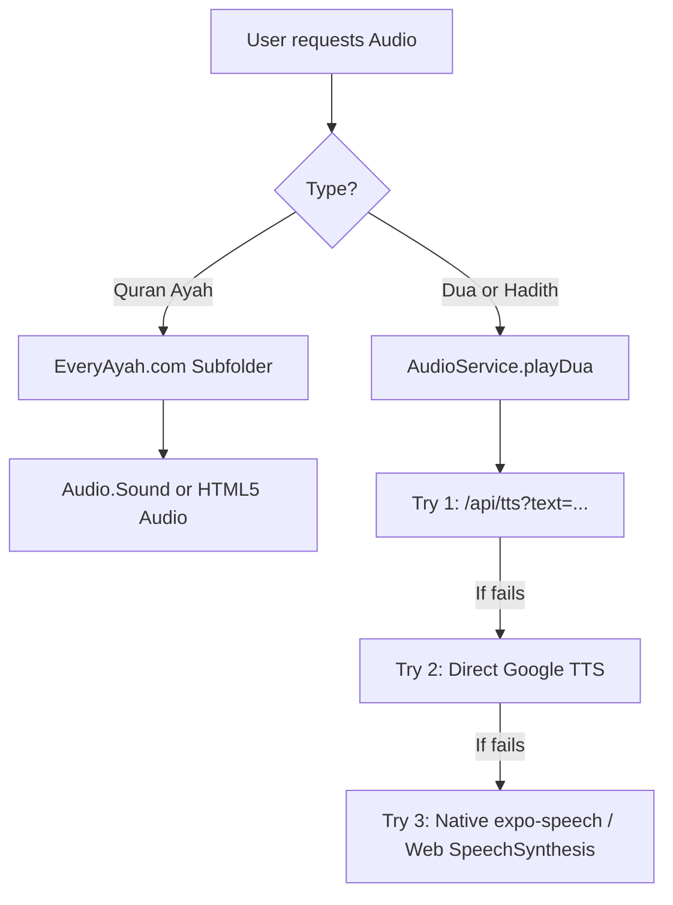

# Noor Kids (نور للأطفال) — Master Architecture & Context Guide

> **Target Audience:** Muslim children aged 4–12 and their parents/educators.  
> **Core Mission:** An enchanting, gamified, ad-free Islamic learning universe combining authentic Quran, Sunnah, Prophets' stories, and moral character education.

---

## 1. Technical Stack

| Layer | Technology |
|---|---|
| **Framework** | Expo SDK 54 / React Native 0.79 / React 19 |
| **Router** | Expo Router v5 (file-based navigation in `src/app/`) |
| **Language** | TypeScript (strict typing) |
| **State Management** | Zustand (`src/store/useAppStore.ts`) with AsyncStorage persistence |
| **Styling** | React Native `StyleSheet` + `LinearGradient` + custom theme tokens (`src/constants/theme.ts`) |
| **Audio Services** | Unified Audio Service (`src/services/audioService.ts`): EveryAyah MP3s (Quran) + TTS MP3 streaming with proxy & Speech fallback (Duas) |
| **Platform Target** | Universal: Web, iOS, Android (mobile-first layout with desktop shell adaptation) |

---

## 2. Directory Structure & Key Files

```
g:/quran app for kids/
├── assets/                     # Static icons, splash images, and badges
├── dist/                       # Production web export bundle (served via server.js)
├── scripts/                    # Utilities & data verification scripts
├── src/
│   ├── app/                    # Expo Router Screens (Routes only)
│   │   ├── _layout.tsx         # Root Stack Navigator & font/RTL setup
│   │   ├── index.tsx           # Home Screen: Magical Journey & 4 Worlds
│   │   ├── onboarding.tsx      # Child Profile & Age Band Onboarding
│   │   ├── quran/
│   │   │   ├── index.tsx       # 114 Surah Catalog with search & juz filter
│   │   │   ├── [surahId].tsx   # Interactive Surah Reader, Player, Tafsir
│   │   │   └── repeat.tsx      # Hifz Repeater Engine (1x–10x kid loop)
│   │   ├── sunnah/
│   │   │   ├── index.tsx       # Sunnah Path & Daily Habits Tracker
│   │   │   ├── [hadithId].tsx  # Hadith Card & Discussion Questions
│   │   │   └── duas.tsx        # Daily Duas with instant Arabic audio
│   │   ├── prophets/
│   │   │   ├── index.tsx       # 25 Prophets Chronological Timeline
│   │   │   └── [prophetId].tsx # Interactive Story Reader & Quiz
│   │   ├── manners/
│   │   │   ├── index.tsx       # Good Manners Town (10 Landmarks)
│   │   │   └── [valueId].tsx   # Scenario Simulation & Ethical Choices
│   │   ├── rewards/index.tsx   # Badge Showcase & Sticker Album
│   │   ├── progress/index.tsx  # Gamification Dashboard & Avatar Customizer
│   │   └── parents/index.tsx   # Parental Gate, Reciters, Translations & PIN
│   ├── components/             # Reusable UI Components
│   │   ├── AudioPlayerBar.tsx  # Global Ayah recitation bar + 27 Reciters modal
│   │   ├── Header.tsx          # Top bar with currency and avatar
│   │   ├── MascotNoor.tsx      # Animated Noor guide character
│   │   ├── DailyMissionCard.tsx# Daily quest tracker with progress bar
│   │   └── StarRewardCelebration.tsx # Confetti & reward modal
│   ├── constants/
│   │   ├── i18n.ts             # Bilingual strings (Arabic & English)
│   │   └── theme.ts            # Palette, shadows, radii, typography
│   ├── data/                   # Verified Content Datasets
│   │   ├── quranData.ts        # 114 Surahs, 27 Reciters, 3 English Translations
│   │   ├── hadithData.ts       # Authenticated Hadiths with Sunnah.com references
│   │   ├── duasData.ts         # Authentic daily prayers & context
│   │   ├── prophetsData.ts     # 25 Prophets' stories & quizzes
│   │   ├── mannersData.ts      # 10 Moral buildings & interactive dilemmas
│   │   └── avatarData.ts       # Kid avatar options, badges, stickers
│   ├── services/
│   │   ├── audioService.ts     # Audio playback engine (EveryAyah + TTS Proxy)
│   │   └── contentService.ts  # Typed query helpers for content datasets
│   └── store/
│       └── useAppStore.ts      # Zustand root store with hydration & state
├── server.js                   # Node static server + /api/tts streaming proxy
├── package.json
├── tsconfig.json
├── prd.md                      # Detailed Product Requirements Document
├── AGENTS.md                   # Agent guidelines & command index
└── CONTEXT.md                  # This file
```

---

## 3. Four Core Learning Worlds

### 1. Quran Garden (حديقة القرآن)
- **Catalog:** All 114 Quran Surahs with exact metadata (Ayah count, Revelation type: Meccan/Medinan).
- **Reciters:** 27 world-class reciters verified against `https://everyayah.com/data/`.
- **Translations:** Saheeh International, The Clear Quran (Dr. Mustafa Khattab), M.A.S. Abdel Haleem.
- **Hifz Engine:** Ayah-by-ayah loop repeater (1x to 10x), speed adjustment (0.75x, 1x, 1.25x), memorization status tracking (`new` -> `learning` -> `memorized`).

### 2. Sunnah Path (طريق السنّة والأذكار)
- **Hadiths:** Authenticated hadiths from Sahih al-Bukhari, Sahih Muslim, Sunan Abi Dawud, Jami` at-Tirmidhi.
- **Duas (حصن المسلم الصغير):** Daily supplications for waking, eating, leaving home, sleeping, etc.
- **Audio:** High-quality streaming Arabic pronunciation via `/api/tts?text=...` (node server proxy) + Google TTS direct fallback + device speech synthesis.

### 3. Prophets’ Caravan (قافلة الأنبياء)
- **Catalog:** All 25 authentic Prophets mentioned in the Quran in chronological order from Adam (ع) to Muhammad (ﷺ).
- **Format:** Divided into bite-sized chapters for bedtime reading or self-paced discovery.
- **Interactive Quizzes:** 3-question multiple choice quizzes at the end of each story to reinforce lessons.
- **Crucial Rule:** STRICT prohibition of face or body depictions of the Prophets (PRD Section 3.2).

### 4. Good Manners Town (بلدة الأخلاق والآداب)
- **Landmarks:** 10 interactive buildings:
  1. House of Truthfulness (بيت الصدق)
  2. School of Kindness (مدرسة اللطف والرفق)
  3. Garden of Honoring Parents (حديقة بر الوالدين)
  4. Clinic of Patience (عيادة الصبر)
  5. Treasury of Trustworthiness (خزانة الأمانة)
  6. Square of Justice (ساحة العدل)
  7. Neighborhood of Good Neighbors (حي الجار الطيب)
  8. Park of Gratitude (منتزه الشكر والامتنان)
  9. Oasis of Generosity (واحة الكرم والإيثار)
  10. Library of Humility (مكتبة التواضع)
- **Simulations:** Kids face real-life moral choices and earn stars for righteous decisions.

---

## 4. Audio Pipeline Architecture



---

## 5. UI & Design System

- **Desktop Layout:** Two-column shell (`width >= 820px`) with left navigation rail, brand mark `☼ noor kids`, journey navigation, and 7-day habit streak widget.
- **Mobile Layout:** Fluid single-column with top header and fixed bottom navigation bar (`Home`, `Learn`, `Duas`, `Treasures`, `Parents`).
- **Hero Banner:** Oasis night adventure with layered green rolling hills (`#44a978`, `#7bc28c`, `#b0d88f`), golden crescent moon (`☾`), twinkling stars (`✦`), curved pathway, and warm glowing lantern (`🏮`).
- **World Colors:**
  - Quran Garden: `#e5f5df` to `#daf0e6` (Mint pastel)
  - Sunnah Path: `#fff1ce` to `#ffe6c9` (Warm Apricot pastel)
  - Prophets' Caravan: `#e9e8fb` to `#dceafa` (Soft Lavender Blue)
  - Good Manners Town: `#ffe8dc` to `#fce3ed` (Peach Rose)

---

## 6. Essential Dev Commands

```bash
# Start Web Dev Server (Port 8081)
npx expo start --web --port 8081

# Start Node Production / Proxy Server (Port 3000)
node server.js

# Export static production web bundle
npx expo export --platform web

# Code Health (MUST PASS BEFORE COMPLETING TASKS)
npx tsc --noEmit
npx expo lint
```
